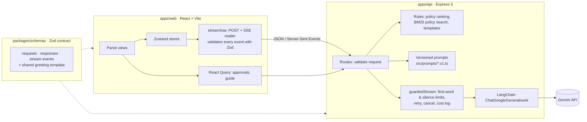

# AI Approvals Panel

An approvals assistant for an operations dashboard, rebuilt from the Crystal Ball Wave 2 take-home brief. Five actions, each backed by a guarded LLM call with a tested rule-based fallback:

| Action | What it does |
|---|---|
| **Present me Summary** | Prioritised summary of the pending queue. Rule-ranked cards appear instantly, then AI text streams in, validated field by field. Can be read aloud, with pause, resume and stop. |
| **Talk to me** | Multi-turn chat about the queue, streamed token by token. |
| **Help me** | Answers from the approval policy (BM25 retrieval + grounded answer), with sources. |
| **Teach me** | A 5-step review guide taken from the policy, with AI answers to follow-up questions. |
| **Replay Greeting** | An instant greeting with live counts. AI wording is optional and checked. |

Stack: React 19 + Vite, Express 5, TypeScript (strict), Zod, Zustand, React Query, LangChain.js, Google Gemini. Tests: Jest + Supertest, Vitest + Testing Library, Playwright.

---

## AI note

**AI-necessary vs. AI-unnecessary.** Each action uses the LLM only for what rules cannot do. Ranking the queue is rules: a policy table plus each item's own override, so the order never depends on the model. The summary uses AI only to explain that fixed order. Help me finds policy sections with BM25 and asks the model to phrase an answer from them; if nothing matches, no AI call is made. Teach me's steps come straight from the policy; AI only answers follow-up questions. Talk to me is the one action that truly needs an LLM, because free conversation has no rule-based equivalent. Replay Greeting does not need AI at all: a template with live counts is instant and never wrong, so AI wording is opt-in and checked before use.

**Fallback design.** Every call goes through one guard: 8 s to the first token, a 5 s silence limit, one quick retry, and cancellation when the user leaves. Structured output is parsed as it streams and validated with Zod. On any failure the user gets a rule-based answer (rule summary, matching policy text, the fixed step, or the template) with a short note, never a 500 or a frozen panel.

**With more time**, I would add a promptfoo eval suite so prompt changes are tested like code.

---

## Quick start

Requirements: Node.js 22 or newer, npm 10 or newer.

```bash
npm install
cp apps/api/.env.example apps/api/.env
```

Put a Google AI Studio key in `apps/api/.env` as `GOOGLE_API_KEY=…` ([get one](https://aistudio.google.com/apikey)). **The app also runs without a key**: every action then serves its rule-based answer with an "AI unavailable" note, which is a quick way to see the fallbacks.

```bash
npm run dev
```

This starts the API on http://localhost:4000 and the web app on http://localhost:5173.

### Tests

```bash
npm test                               # API (Jest + Supertest) and web (Vitest) unit + integration tests
npm run typecheck                      # strict TypeScript in every workspace
npx playwright install chromium        # once, for the end-to-end tests
npm run test:e2e                       # Playwright: real browser, real API, fake Gemini
```

The end-to-end suite starts its own web app, API and fake Gemini server on ports 5174, 4100 and 4900, so it does not clash with `npm run dev`. It never calls Google and never uses your key.

### Configuration (`apps/api/.env`)

| Variable | Default | Purpose |
|---|---|---|
| `GOOGLE_API_KEY` | (none) | Gemini key. Without it, every action uses its fallback. |
| `AI_MODEL` | `gemini-3.1-flash-lite` | Any Gemini model that supports streaming. |
| `AI_FIRST_TOKEN_TIMEOUT_MS` | `8000` | Max wait for the first word, including the one retry. |
| `AI_IDLE_TIMEOUT_MS` | `5000` | Max silence once the reply has started. |
| `AI_MIN_RETRY_WINDOW_MS` | `1500` | Retry only if this much of the first-word budget is left. |
| `AI_MAX_TOKENS` | `1024` | Max reply length. |
| `AI_RATE_LIMIT_PER_MINUTE` | `20` | AI requests per browser session per minute. |
| `AI_RATE_LIMIT_PER_IP_PER_MINUTE` | `60` | Backstop per IP address (a cleared cookie starts a new session). |
| `AI_BASE_URL` | Google | Another Gemini endpoint (the E2E fake uses this). |
| `AI_PRICE_INPUT_PER_MTOK` / `AI_PRICE_OUTPUT_PER_MTOK` | `0` | US$ per million tokens for the cost log (0 = free tier). |
| `PORT`, `WEB_ORIGIN` | `4000`, `http://localhost:5173` | API port, and the only origin allowed by CORS. |

Invalid values stop the API at startup with the variable's name, rather than misbehaving later.

---

## Architecture



**One contract.** `packages/schemas` defines every request, response and stream event with Zod. The API validates requests before doing anything and validates its own responses before sending them. The browser validates every event it receives, so a malformed or unexpected event becomes a friendly error, never rendered text.

**One AI path.** Every model call goes through `guardedStream` ([apps/api/src/ai/guardedStream.ts](apps/api/src/ai/guardedStream.ts)). It races each step against its own abort signal, so neither a hung connection nor a silent stream can outlast the limits. It yields chunks and then exactly one end event, and never throws. A shared SSE writer ([apps/api/src/ai/sse.ts](apps/api/src/ai/sse.ts)) turns that into `token → done` or `notice → fallback → done` events.

**Rate limits on every AI endpoint.** Each browser gets an anonymous, http-only session cookie on its first AI request (there is no login). Each session may make 20 AI requests a minute, and a per-IP backstop of 60 a minute stops a client that clears its cookie to get a fresh allowance. Over the limit, the API answers with a JSON `429 { error: { code: "rate_limited", message } }` that says how long to wait (in English or Hindi), plus `Retry-After` and standard `RateLimit` headers. The blocked request never reaches Gemini. Every action shows that message with a Try again option. The counters live in memory ([apps/api/src/middleware/rateLimit.ts](apps/api/src/middleware/rateLimit.ts)); with several API instances they would move to a Redis store.

**Prompts are code.** Each prompt is a versioned export in [apps/api/src/prompts](apps/api/src/prompts) (`summary.v1.ts`, `talk.v1.ts`, `help.v1.ts`, `teach.v1.ts`, `greeting.v1.ts`), selected in `prompts/index.ts` and unit-tested. Queue and policy text are passed as data inside tagged blocks, and the prompt tells the model to treat them as data, not instructions.

### How each action works

| Action | Without AI (always) | With AI | If the AI fails |
|---|---|---|---|
| Summary | Policy-ranked cards are sent at once (`skeleton` event) | Gemini JSON mode with a schema. The server parses each cut-off piece, sends only appended text for known fields and known item ids, and checks each item as soon as it closes. The final summary is validated and kept in ranked order. | The rule-based summary (EN/HI). An empty queue makes no AI call. |
| Talk | Queue goes into the system prompt as data | Last 12 messages; same-side turns merged (Gemini needs alternation) | "I can't chat right now" + shortcuts to the actions that still work |
| Help | BM25 search over the policy's sections; no match means no AI call | The model answers only from the matched sections and cites the section number | The matching policy sections, word for word |
| Teach | Steps parsed from the policy's numbered list | Follow-ups answered from the current step + policy text found for it; one thread per step | The step again + the related policy text |
| Greeting | Template with live counts, built in the browser (no request) | Optional rewording; rejected if it changes or invents a number | The template stays, with a quiet note |

### API

| Endpoint | Purpose |
|---|---|
| `GET /api/approvals` | Ranked queue (no AI) |
| `GET /api/teach/guide` | Review steps from the policy (no AI) |
| `POST /api/ai/summary` | Summary stream |
| `POST /api/ai/talk` | Chat reply stream |
| `POST /api/ai/help` | Policy answer stream, with a `citations` event first |
| `POST /api/ai/teach` | Follow-up answer stream for one step |
| `POST /api/ai/greeting` | Optional AI wording of the greeting |
| `GET /api/health` | Health check |

All AI endpoints return `text/event-stream` with status 200 once streaming starts. Invalid requests get a JSON `400 { error: { code, message } }` before any AI call, and requests over the rate limit get a JSON `429` with a please-wait message. Unknown routes get a JSON 404. Crashes become a friendly JSON 500 whose details are logged on the server, never sent to the client.

### Data

- [apps/api/data/approvals.json](apps/api/data/approvals.json): the four items from the brief, with a `category` and one optional per-item `priority` override.
- [apps/api/data/approval-policy.md](apps/api/data/approval-policy.md): the policy (**placeholder text for now**). The code reads its "Priority by category" table for ranking and its numbered "How to review" list for Teach me. Help me searches all of its sections.

Both are validated when the API starts, so a broken table or bad item fails fast.

### Cost log

Every AI call writes one JSON line to stdout: feature, model, outcome, failure reason, attempts, input/output tokens, cost, total latency and time to first word.

```json
{"event":"ai_call","at":"2026-10-27T07:04:05.168Z","feature":"summary","model":"gemini-3.1-flash-lite","outcome":"complete","attempts":1,"inputTokens":510,"outputTokens":269,"costUsd":0,"latencyMs":2367,"firstTokenMs":1620}
```

---

## Testing

| Layer | Tool | Count | Highlights |
|---|---|---|---|
| Unit + integration (API) | Jest + Supertest | 285 | Every AI endpoint: success, Gemini down, first-word timeout, cut short, broken / wrong-shape / reordered AI output, missing key, bad input, rate limits. The real LangChain + Google SDK run against a fake HTTP layer. |
| Unit + component (web) | Vitest + Testing Library | 102 | Loading, streaming and error states of every view; the please-wait message; malformed events never rendered; abort on close. |
| End-to-end | Playwright | 18 | All five actions in Chromium against a scripted fake Gemini, including failure paths and the rate limit. |

Learning tests ([apps/api/test/learning](apps/api/test/learning)) record how LangChain's Gemini client really behaves (streaming, abort, usage, errors) before the design relies on it.

**Test-first history.** Each feature is two commits on `main`: `test: failing tests for …`, then `feat: …` making them pass. Run `git log --oneline` to see the pairs. Bugs found along the way got a failing test before the fix. Examples: an unhandled promise rejection in the Google SDK on cancel (it would crash Node), and React StrictMode sending two Summary requests per open in development.

---

## Assumptions and deviations

The brief invites questions where it is ambiguous. These are the calls I made, and why.

| Topic | Brief | What I did | Why |
|---|---|---|---|
| Frontend | React + Next.js | **React + Vite** | The panel is a fully client-side interactive widget: Server Components add nothing, and Vite shares its config with Vitest. A deliberate deviation. |
| LLM | Claude API or GPT-4o | **Google Gemini** via LangChain (`gemini-3.1-flash-lite`) | Cost: Gemini has a free tier. LangChain keeps the provider swappable. `gemini-2.5-flash` was tried first, but its free tier allows only 20 requests a day. |
| Streaming vs. structured output | Both, for the summary | Cards from rules first; the AI's JSON is parsed while streaming; only checked text for known fields reaches the browser; the final object is validated | Satisfies "first token renders immediately" and "validated before the UI" together. |
| "Prioritised by urgency" | Not in the dataset | A policy table (category → default priority) plus an optional per-item `priority` override, applied by code | The dataset has no urgency signal; letting the model rank would not be repeatable or checkable. |
| 8 s timeout | Per call | 8 s to the **first word** (one quick retry inside that budget), then a 5 s silence limit | A long but healthy answer is not cut off; a stalled one is. |
| RAG | Keyword or in-memory is fine | Own small **BM25**, shaped as a LangChain `BaseRetriever` | `@langchain/community`'s retriever cannot be installed next to Zod 4 without disabling npm's peer checks, and it does no stopword removal. Production path: embeddings + pgvector. |
| Hindi | "Operator's language" | EN / हिं toggle; the AI replies in Hindi; fixed texts exist in both | The JD targets Hindi-speaking states. Help me's keyword search reads English, so a question written only in Hindi gets the whole (short) policy, still with "answer only from this" grounding. |
| Teach me | Adapts to follow-ups | Steps fixed from the policy; AI only for follow-ups | Consistent, correct steps; AI where it adds value. |
| Greeting | Context-aware, not fixed | Template by default, AI wording optional and checked | The clearest "AI not needed" case. |
| Dashboard scope | The panel | Panel + a read-only approvals table | Gives the panel context without rebuilding the full dashboard. |
| "Per-session" rate limiting | Basic, explained | Anonymous session cookie (20/min) + per-IP backstop (60/min) on `/api/ai/*` only | There is no login, so the cookie is the session; the IP limit stops cookie clearing from bypassing it. |

---

## Status and known limitations

- **Rate-limit counters are in memory**: they reset when the API restarts and are per instance. A Redis store would share them across instances.
- **Free-tier quota.** Gemini's free tier has daily limits per model. When they are reached, Gemini returns 429 and every action shows its fallback; 429 is deliberately not retried. Set `AI_MODEL` to switch models.
- **Placeholder policy.** `approval-policy.md` is sample text; the Help me search tests run against it and should be re-checked when it is replaced.
- **Hindi.** Item titles and policy text stay in English inside Hindi answers.
- **No authentication or persistence.** The seed data is read-only, and conversations live in the browser session.
- **Not deployed.** It runs locally with the steps above.
- **Small wording nit:** the shared "AI unavailable" note says "here is a rule-based answer", which reads oddly above Talk to me's backup text.

---

## Project structure

```
apps/
  api/                 Express API
    data/              seed approvals + approval policy
    src/ai/            guardedStream, SSE writer, model setup, errors, cost log, notices (EN/HI)
    src/bootstrap/     startup dependency and data assembly
    src/features/      approvals, greeting, help, summary, talk, and teach modules
      <feature>/       router, controller, and feature-specific logic
    src/policy/        priority rules and shared policy retrieval/search
    src/prompts/       versioned prompts (*.v1.ts)
    src/middleware/    session cookie, rate limits, error handling
    src/router/        API route composition and health route
    src/types/         shared application dependency contracts
    test/              unit, integration, learning tests + fake Gemini helper
  web/                 React + Vite app
    src/api/           fetch + SSE clients (validate everything)
    src/state/         Zustand stores (panel, summary, chat, help, teach, greeting)
    src/components/    approvals table, assistant panel and its views
packages/schemas/      shared Zod contract + greeting template
e2e/                   Playwright journeys + fake Gemini server
```

---

## Where AI tools were used

The brief expects AI tools and asks where they were used. This project was built pair-programming with **Claude Code** (Anthropic's coding agent):

- **Planning.** We walked through the brief and the JD together, listed the ambiguous points, and settled each decision in the table above one at a time. Claude Code proposed options with trade-offs; I made the calls, sometimes against its recommendation (Vite instead of Next.js, Gemini instead of Claude, LangChain throughout).
- **Building.** For each feature it wrote the failing tests first, committed them, then wrote the code to make them pass, following the test-first commit pattern above.
- **Checking.** It ran every suite repeatedly to catch flaky timing tests. It also checked each feature live, against the real Gemini API and in a browser, including failure paths (no key, a bad request, Gemini's quota running out).
- **Catching problems.** Examples: a real API key pasted into the committed `.env.example` (moved to the git-ignored `.env` before any commit), the Google SDK's unhandled rejection on cancel, the StrictMode double request, the npm/Zod conflict with `@langchain/community`, and the free-tier quota running out mid-testing.
